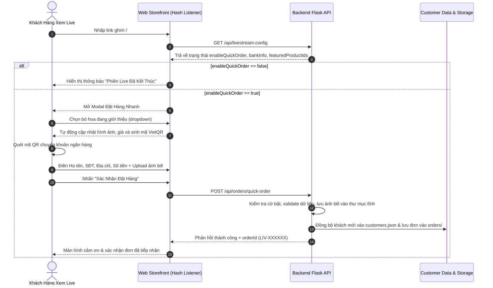
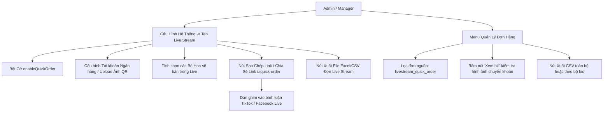

# Thiết Kế Phân Hệ Bán Hàng Trực Tiếp Live Stream & Đặt Hàng Tốc Hành (Live Stream Quick Order Design)
## Dự Án: Nở Hoa Thả Bình (`telua_flower`)

---

## 1. Tổng Quan Phân Hệ & Bối Cảnh Nghiệp Vụ (Overview & Business Context)

Phân hệ **Live Stream Quick Order (Bán Hàng Trực Tiếp & Đặt Hàng Tốc Hành)** được thiết kế nhằm đáp ứng nhu cầu chốt đơn nhanh chóng trong các buổi phát sóng trực tiếp (TikTok Live, Facebook Live, Shopee Live, Zalo Video).

### Vấn đề cần giải quyết:
1. **Rào cản chốt đơn cao:** Quy trình đặt hoa truyền thống (duyệt danh mục $\rightarrow$ xem chi tiết $\rightarrow$ thêm giỏ $\rightarrow$ chọn thiệp $\rightarrow$ chọn ngày giờ $\rightarrow$ đăng nhập $\rightarrow$ thanh toán) quá dài khiến khách hàng xem livestream dễ mất kiên nhẫn hoặc thoát trang.
2. **Nhu cầu chốt nóng trong 15-30 giây:** Khách live stream cần thao tác ngay lập tức: chọn mẫu hoa đang xem, quét QR chuyển khoản, để lại SĐT và địa chỉ để shop đóng gói giao tức thì trong 2H.
3. **Cơ chế kiểm soát thời điểm live:** Chủ shop (Admin) cần công tắc Bật/Tắt chủ động; khi không live, link tự chuyển hướng hoặc thông báo phiên live đã tạm dừng.
4. **Xuất báo cáo chốt ca live:** Sau khi tắt live, quản lý cần xuất ngay danh sách các đơn đã chốt và link hình ảnh chuyển khoản ra file Excel để thợ cắm hoa và shipper triển khai đơn hàng.

---

## 2. Kiến Trúc Luồng Vận Hành (System & Workflow Architecture)

### A. Luồng Đặt Hàng Phía Khách Hàng (Customer Flow)


### B. Luồng Quản Trị & Xuất Thông Tin Phía Admin (Admin Operational Flow)


---

## 3. Cơ Chế Đường Dẫn Băm (Hash URL Routing)

Hệ thống sử dụng cơ chế lắng nghe sự kiện `hashchange` và kiểm tra `window.location.hash` ngay khi tải trang (`DOMContentLoaded`):

- **Đường dẫn kích hoạt hợp lệ:**
  - `https://domain.vn/#quick-order`
  - `https://domain.vn/#livestream`
  - `https://domain.vn/#live`
- **Xử lý phía Client:**
  - Khi phát hiện một trong các hash trên, hàm `openQuickOrderModal()` được kích hoạt ngay lập tức.
  - Tải cấu hình từ API `/api/livestream-config`.
  - Nếu `enableQuickOrder = true`, nạp danh sách hoa ghim từ `featuredProductIds` vào dropdown chọn hoa, hiển thị card thông tin ngân hàng và mã QR.
  - Nếu `enableQuickOrder = false`, hiển thị màn hình thông báo phiên live tạm nghỉ và nút "Xem Danh Mục Hoa" chuyển về trang chủ.

---

## 4. Đặc Tả Giao Diện Người Dùng (UI Specification)

### A. Modal Đặt Hàng Nhanh (`#quickOrderModal`)
1. **Phần đầu trang (Header):**
   - Huy hiệu `🔴 TRỰC TIẾP (LIVE)` có chấm nháy động (`animate-pulse`).
   - Tiêu đề cấu hình được (mặc định: *Chốt Đơn Nhanh - Phiên Live Đặc Biệt*).
   - Lời dặn dò ngắn gọn.
2. **Khối Chọn Bó Hoa Đang Live:**
   - Dropdown chọn bó hoa từ danh sách Admin đã ghim.
   - Khi chọn, tự động hiển thị thẻ xem trước (Card preview) gồm: thumbnail hoa, tên hoa, giá niêm yết màu hồng sen nổi bật.
3. **Khối Thanh Toán Chuyển Khoản:**
   - Mã QR thanh toán: Ưu tiên ảnh QR shop tải lên; nếu chưa tải, tự động sinh mã VietQR động theo cấu trúc:
     `https://img.vietqr.io/image/<BANK>-<ACC>-compact.png?amount=<PRICE>&addInfo=HOA <PHONE>`
   - Số tài khoản, Ngân hàng, Chủ tài khoản kèm nút sao chép nhanh STK.
4. **Biểu mẫu thông tin nhận hàng:**
   - Họ và tên khách hàng (Bắt buộc).
   - Số điện thoại nhận hoa (Bắt buộc, 10 số).
   - Địa chỉ giao hàng chi tiết (Bắt buộc).
   - Số tiền đã chuyển khoản (Tự động điền theo giá bó hoa, cho phép sửa nếu khách cọc trước).
   - Upload ảnh chụp màn hình hóa đơn / bill chuyển khoản (Hỗ trợ file ảnh hoặc camera điện thoại).
   - Lời chúc thiệp / Ghi chú giao hàng (Tùy chọn).
5. **Màn hình thành công (Success Screen):**
   - Mã đơn hàng dạng `LIV-XXXXXX`.
   - Thông báo shop đang chuẩn bị hoa và liên hệ xác nhận trong 5 phút.

### B. Tab Quản Trị Live Stream (`tabSysContentLiveStream`)
Nằm trong modal **Cấu Hình Hệ Thống** (`#systemConfigModal`), gồm các khối chức năng:
1. **Công tắc tổng:** Switch bật/tắt `enableQuickOrder`.
2. **Đường dẫn chia sẻ (Share link widget):**
   - Ô hiển thị đường link hash đầy đủ theo domain hiện hành.
   - Nút **Sao Chép Link** (Copy to clipboard kèm toast thông báo).
   - Nút **Chia Sẻ Link** (Hỗ trợ `navigator.share` trên thiết bị di động).
   - Nút **Mở Thử** (Khởi chạy modal ngay trên tab admin để kiểm tra).
3. **Cấu hình Thông Tin Chuyển Khoản:** Tên ngân hàng, Số tài khoản, Chủ tài khoản.
4. **Mã QR Chuyển Khoản Ngân Hàng (Hỗ trợ kép URL Trực Tiếp & Tải Tệp Ảnh):**
   - **Hỗ trợ dán đường dẫn URL:** Ô nhập `adminLiveStreamQrUrlInput` cho phép dán trực tiếp bất kỳ link ảnh QR nào (VietQR, CDN, Cloud, Imgur, app ngân hàng).
   - **Hỗ trợ Tải ảnh lên:** Nút tải file ảnh `adminLiveStreamQrFileInput` đẩy tệp ảnh lên máy chủ qua `/api/admin/upload-image` và tự điền URL vào ô input.
   - **Tiện ích Tạo VietQR tự động:** Nút "Tạo VietQR" (`generateAutoVietQrForLiveStream`) tự động sinh URL ảnh VietQR chuẩn theo Số Tài Khoản và Ngân Hàng đã điền ở mục 2.
   - **Khung xem trước & Xử lý trạng thái hiển thị thời gian thực:**
     ```javascript
     if (qrImg) {
         qrPreview.src = qrImg;
         if (qrRemoveBtn) qrRemoveBtn.classList.remove("hidden");
         if (qrStatus) {
             qrStatus.textContent = qrImg.startsWith("data:") ? "Mã QR đã tải lên (Tệp ảnh)" : "Mã QR chuyển khoản riêng (URL / Đã tải)";
             qrStatus.className = "text-[10px] text-emerald-600 font-bold block mt-1";
         }
     } else {
         qrPreview.src = "https://img.vietqr.io/image/VCB-0976491322-compact2.png?amount=0&addInfo=LIVE";
         if (qrRemoveBtn) qrRemoveBtn.classList.add("hidden");
         if (qrStatus) {
             qrStatus.textContent = "Mã VietQR tự động theo số tài khoản";
             qrStatus.className = "text-[10px] text-gray-500 font-medium block mt-1";
         }
     }
     ```
   - **Nút Xóa Ảnh:** Cho phép gỡ bỏ ảnh riêng, đưa ô URL về rỗng và tự động quay về mã VietQR mặc định.
5. **Chọn Bó Hoa Giới Thiệu Trong Live:** Danh sách checkbox nạp từ danh mục sản phẩm của shop; Admin chỉ cần tích chọn các mẫu hoa sẽ mang lên sóng livestream.
6. **Báo Cáo & Xuất Dữ Liệu:** Nút **"📥 Xuất File Excel / CSV (Chuyên Live Stream)"** và nút chuyển nhanh đến trang Quản lý đơn hàng.

### C. Tab Quản Trị Đơn Hàng Live Stream Độc Lập (`tabContentLivestreamOrders`)
Nằm trực tiếp trên thanh điều hướng chính của **Cổng Quản Trị Hệ Thống** (`#adminPortalModal`), được thiết kế để xử lý tức thì các đơn hàng đổ về trong lúc phát sóng:
1. **Thẻ Thống Kê Nhanh (KPI Stats Counter):**
   - Tổng đơn Live Stream.
   - Đơn chờ xác nhận thanh toán (`pending`).
   - Đơn đang cắm hoa (`arranging`).
   - Đơn đang giao (`shipping`).
   - Đơn hoàn thành giao hoa (`delivered`).
   - Tổng doanh thu chốt từ phiên Live Stream.
2. **Bảng Danh Sách Đơn Hàng Trực Tiếp:**
   - Hiển thị đầy đủ: Mã đơn, Thời gian, Tên khách hàng & SĐT, Địa chỉ nhận, Mẫu hoa đã chọn, Số tiền chuyển khoản, Ảnh bill, Trạng thái đơn, Ảnh hoa thực tế sau khi cắm, Thao tác xử lý.
3. **Modal Chi Tiết Đơn & Quy Trình Thao Tác 4 Bước Của Shop (`#adminLiveOrderDetailModal`):**
   - **Bước 1 - Xác Nhận Chuyển Khoản & Tiếp Nhận:** Shop đối chiếu ảnh bill chuyển khoản của khách, bấm nút **"Xác Nhận & Bắt Đầu Cắm Hoa"** (`status -> arranging`).
   - **Bước 2 - Thợ Cắm Hoa & Tải Ảnh Hoa Thực Tế:** Thợ hoa hoàn thiện bó hoa, chụp ảnh thực tế tải lên hệ thống (`/api/flower/v1/admin/livestream/upload-flower-proof` hoặc `/api/orders/<id>/photo`). Ảnh hoa được lưu trữ an toàn và hiển thị công khai trên phiếu đơn để khách/quản lý nghiệm thu.
   - **Bước 3 - Điều Phối Chi Nhánh & Gán Thông Tin Shipper:** Quản lý chỉ định chi nhánh chịu trách nhiệm thực hiện (`branchId`), đồng thời điền Họ tên Shipper và Số điện thoại Shipper phụ trách giao (`order.delivery.shipperName`, `order.delivery.shipperPhone`). Bấm **"Giao Hàng"** (`status -> shipping`).
   - **Bước 4 - Hoàn Tất Giao Hoa:** Sau khi shipper hoàn thành giao hoa tận tay người nhận, bấm **"Đã Giao Thành Công"** (`status -> delivered`).

### D. Bộ Lọc Theo Ngày & Thanh Trạng Thái Đối Soát (`#filterLiveOrderDate`)
Để phục vụ công tác đối soát doanh thu và kiểm soát đơn theo từng ca phát sóng:
1. **Ô Chọn Ngày Trực Quan:** Thẻ `<input type="date" id="filterLiveOrderDate">` tích hợp ngay trên thanh công cụ của Tab Live Stream.
2. **Phím Tắt Nhanh:**
   - Nút **`[ Hôm nay ]`**: Tự động điền ngày hiện tại và kích hoạt nạp danh sách đơn của phiên live hôm nay.
   - Nút **`[ ✖ Xóa lọc ngày ]`**: Xóa trắng bộ lọc ngày để xem toàn bộ lịch sử đơn livestream.
3. **Thanh Trạng Thái Bộ Lọc (`#liveOrderFilterInfoBar`):**
   - Hiển thị badge ngày đang lọc (Ví dụ: `Đang lọc theo ngày: 2026-10-22`) và tổng số đơn tương ứng.
4. **Tự Động Tính Toán Lại Chỉ Số:** Khi thay đổi ngày lọc, toàn bộ thẻ KPI và tổng doanh thu được tính toán lại theo đúng ngày được chọn.

---

## 5. Cơ Chế Xuất Dữ Liệu Đơn Hàng (Excel / CSV Export Engine)

Nhằm đảm bảo tương thích hoàn hảo với Microsoft Excel trên hệ điều hành Windows, module xuất CSV áp dụng kỹ thuật **UTF-8 Byte Order Mark (BOM)**:

```javascript
// Thêm ký tự UTF-8 BOM \uFEFF vào đầu chuỗi CSV để Excel hiển thị đúng Tiếng Việt có dấu
const csvContent = '\uFEFF' + headers.join(',') + '\n' + rows.map(r => r.join(',')).join('\n');
const blob = new Blob([csvContent], { type: 'text/csv;charset=utf-8;' });
```

### Các trường thông tin trong tệp xuất:
1. **Mã Đơn:** `order_id` (Ví dụ: `LIV-1740001234`)
2. **Thời Gian:** Ngày giờ tạo đơn theo định dạng `DD/MM/YYYY HH:mm`
3. **Nguồn Đơn:** `livestream_quick_order`
4. **Khách Hàng:** Họ và tên
5. **Số Điện Thoại:** SĐT người nhận
6. **Địa Chỉ Giao Hàng:** Địa chỉ chi tiết
7. **Sản Phẩm Đã Chọn:** Tên bó hoa / sản phẩm khách đã click
8. **Số Tiền Đã Chuyển:** Số tiền thanh toán (VND)
9. **Tổng Tiền Đơn Hàng:** Giá trị bó hoa (VND)
10. **Ảnh Bằng Chứng:** URL xem ảnh chụp bill chuyển khoản
11. **Ảnh Hoa Sau Cắm:** URL ảnh chụp hoa thực tế của shop trước khi giao
12. **Thông Tin Shipper:** Họ tên & SĐT tài xế giao hoa
13. **Trạng Thái Đơn:** `Chờ xác nhận thanh toán` / `Đang xử lý` / `Đang giao` / `Đã giao`
14. **Ghi Chú:** Lời nhắn gửi / yêu cầu giao hoa của khách

---

## 6. Cấu Trúc Dữ Liệu Lưu Trữ (Data Storage Schemas)

### A. Tệp Cấu Hình `config/anne/livestreamConfig.json`
```json
{
  "enableQuickOrder": true,
  "title": "Chốt Đơn Nhanh - Phiên Live Đặc Biệt",
  "description": "Quý khách vui lòng chọn bó hoa đang live, chuyển khoản thanh toán và để lại thông tin nhận hoa để shop đóng gói giao ngay trong 2H!",
  "bankInfo": {
    "bankName": "Vietcombank",
    "accountNumber": "9976491322",
    "accountHolder": "NO HOA THA BINH"
  },
  "qrCodeImage": "",
  "featuredProductIds": [
    "bo_hoa_01",
    "bo_hoa_02",
    "bo_hoa_03"
  ],
  "updatedAt": "2026-10-22T07:10:00Z"
}
```

### B. Bản Ghi Đơn Hàng Quick Order trong `orders/`
```json
{
  "id": "LIV-1740212345",
  "orderCode": "LIV-1740212345",
  "source": "livestream_quick_order",
  "orderType": "livestream_quick",
  "orderDate": "2026-10-22",
  "orderDay": "2026-10-22",
  "livestreamDate": "2026-10-22",
  "customerName": "Nguyễn Thị Mai",
  "phone": "0912345678",
  "shippingAddress": "123 Cách Mạng Tháng 8, P.5, Q.3, TP.HCM",
  "recipientName": "Nguyễn Thị Mai",
  "recipientPhone": "0912345678",
  "deliveryAddress": "123 Cách Mạng Tháng 8, P.5, Q.3, TP.HCM",
  "items": [
    {
      "productId": "bo_hoa_01",
      "productName": "Bó Hoa Hồng Ecuador Đỏ Rực Rỡ",
      "quantity": 1,
      "price": 650000,
      "image": "/images/products/bo_hoa_01.webp"
    }
  ],
  "selectedProduct": {
    "productId": "bo_hoa_01",
    "productName": "Bó Hoa Hồng Ecuador Đỏ Rực Rỡ",
    "price": 650000,
    "image": "/images/products/bo_hoa_01.webp"
  },
  "payment": {
    "method": "online_transfer",
    "status": "pending_confirmation",
    "amountPaid": 650000,
    "proofImage": "/api/flower/v1/images/orders/proof_LIV_1740212345.webp"
  },
  "transferredAmount": 650000,
  "proofImage": "/api/flower/v1/images/orders/proof_LIV_1740212345.webp",
  "notes": "Giao trước 11h trưa giúp mình",
  "cardMessage": "Giao trước 11h trưa giúp mình",
  "totalAmount": 650000,
  "status": "pending",
  "photoAfterArranged": "/api/flower/v1/images/orders/proof_1792673091_9ef1b1d6.png",
  "delivery": {
    "shipperName": "Trần Văn Giao",
    "shipperPhone": "0909112233"
  },
  "createdAt": "2026-10-22T07:12:00Z"
}
```

### C. Cấu Trúc Sổ Cái Đơn Theo Ngày `config/anne/livestream_orders/{YYYY-MM-DD}.json`
Để tối ưu tốc độ đọc và đối soát phiên live mà không cần quét toàn bộ cây thư mục Kanban đa chi nhánh:
```json
[
  {
    "orderId": "LIV-1740212345",
    "orderCode": "LIV-1740212345",
    "customerName": "Nguyễn Thị Mai",
    "phone": "0912345678",
    "recipientName": "Nguyễn Thị Mai",
    "recipientPhone": "0912345678",
    "deliveryAddress": "123 Cách Mạng Tháng 8, P.5, Q.3, TP.HCM",
    "status": "delivered",
    "totalAmount": 650000,
    "transferredAmount": 650000,
    "proofImage": "/api/flower/v1/images/orders/proof_LIV_1740212345.webp",
    "photoAfterArranged": "/api/flower/v1/images/orders/proof_1792673091_9ef1b1d6.png",
    "shipperName": "Trần Văn Giao",
    "shipperPhone": "0909112233",
    "source": "livestream_quick_order",
    "orderDate": "2026-10-22",
    "createdAt": "2026-10-22T07:12:00Z",
    "updatedAt": "2026-10-22T08:30:00Z"
  }
]
```

---

## 7. Danh Mục API Endpoints

| Method | Endpoint | Quyền hạn | Mô tả |
| :--- | :--- | :---: | :--- |
| `GET` | `/api/livestream-config` | Public | Lấy cấu hình Live Stream công khai (trạng thái `enableQuickOrder`, thông tin ngân hàng, mã QR, danh sách hoa ghim) |
| `GET` | `/api/admin/livestream-config` | Admin / Manager | Lấy cấu hình Live Stream đầy đủ cho trang Quản Trị Hệ Thống |
| `PUT` | `/api/admin/livestream-config` | Admin / Manager | Cập nhật cấu hình Live Stream (Bật/tắt cờ, thông tin ngân hàng, ảnh QR code, chọn hoa ghim) |
| `POST` | `/api/orders/quick-order` | Public | Tiếp nhận đơn đặt hàng nhanh: Validate số điện thoại, kiểm tra cờ bật/tắt, lưu ảnh hóa đơn chuyển khoản, tạo đơn hàng, đồng bộ danh bạ CRM và ghi vào sổ theo ngày |
| `GET` | `/api/admin/orders?source=livestream_quick_order&date=YYYY-MM-DD` | Staff / Manager / Admin | Lấy danh sách đơn hàng đã lọc riêng theo nguồn Live Stream và ngày cụ thể |
| `GET` | `/api/flower/v1/admin/livestream/dates` | Staff / Manager / Admin | Lấy danh sách toàn bộ các ngày có đơn Live Stream phát sinh |
| `GET` | `/api/flower/v1/admin/livestream/orders?date=YYYY-MM-DD` | Staff / Manager / Admin | Đọc siêu tốc danh sách đơn Live Stream trực tiếp từ tệp sổ cái theo ngày |
| `POST` | `/api/flower/v1/admin/livestream/upload-flower-proof` | Staff / Manager / Admin | Tải ảnh chụp hoa thực tế của shop sau khi cắm hoàn thiện cho đơn Live Stream |

---

## 8. Kế Hoạch Kiểm Thử Tự Động (Unit Test Coverage)

Toàn bộ nghiệp vụ phân hệ Live Stream Quick Order được kiểm thử tự động tại [src/unittest/test_livestream_quick_order.py](file:///d:/wmshare/telua_flower/src/unittest/test_livestream_quick_order.py) với 15/15 bài test đạt chuẩn:

| Test Case | Mục Tiêu Kiểm Thử | Kết Quả |
| :--- | :--- | :---: |
| `test_get_and_save_livestream_config_data_service` | Lưu và đọc cấu hình `livestreamConfig.json` | ✅ Pass |
| `test_public_and_admin_livestream_config_endpoints` | Gọi API công khai & quản trị cấu hình `/livestream-config` | ✅ Pass |
| `test_quick_order_creation_when_enabled` | Tạo đơn đặt hàng nhanh khi cờ đang bật | ✅ Pass |
| `test_quick_order_disabled_should_reject` | Chặn tạo đơn khi cờ `enableQuickOrder = false` (HTTP 400) | ✅ Pass |
| `test_quick_order_validation_missing_fields` | Bắt lỗi thiếu Họ tên, SĐT hoặc Địa chỉ nhận hoa | ✅ Pass |
| `test_quick_order_success_with_multipart_file_upload` | Tạo đơn nhanh kèm upload file ảnh hóa đơn thực tế | ✅ Pass |
| `test_quick_order_with_selected_bouquet` | Lưu thông tin bó hoa đã chọn vào danh sách items đơn hàng | ✅ Pass |
| `test_livestream_featured_products_config` | Cấu hình và nạp danh sách hoa ghim `featuredProductIds` | ✅ Pass |
| `test_admin_orders_filter_by_source_livestream` | Lọc danh sách đơn qua API `/admin/orders?source=livestream_quick_order` | ✅ Pass |
| `test_admin_orders_search_livestream_by_phone_and_recipient` | Tìm kiếm đơn Live Stream theo SĐT hoặc Tên người nhận | ✅ Pass |
| `test_admin_orders_livestream_status_filtering` | Lọc đơn Live Stream theo trạng thái (pending, confirmed, etc.) | ✅ Pass |
| `test_order_shortcut_item_contains_source_and_proof` | Kiểm tra tính toàn vẹn `source` & ảnh bill trong `build_order_shortcut_item` | ✅ Pass |
| `test_livestream_toggle_quick_order_workflow` | Luồng bật/tắt nhận đơn Live Stream ảnh hưởng tức thì đến API chốt đơn | ✅ Pass |
| `test_livestream_shop_action_proof_and_shipper_flow` | Quy trình thao tác shop: xác nhận, upload ảnh hoa thực tế, gán shipper, hoàn thành | ✅ Pass |
| `test_livestream_daily_storage_and_date_filter` | Lưu trữ sổ cái theo ngày `livestream_orders/{date}.json` và bộ lọc query theo ngày | ✅ Pass |
